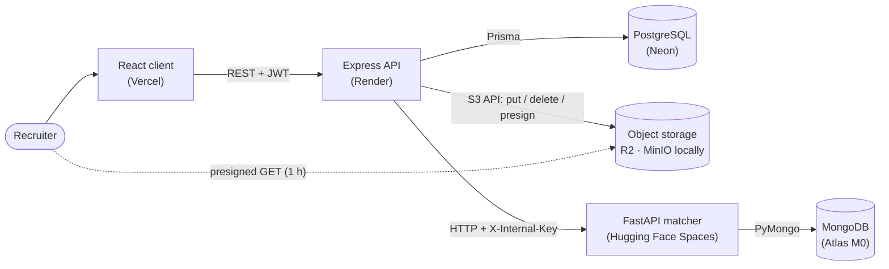
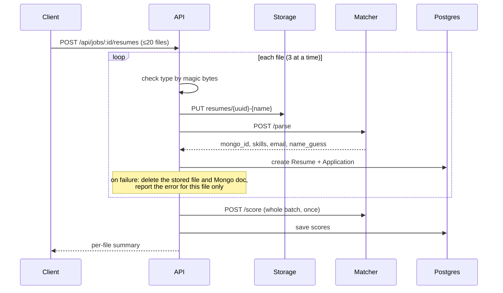

# AI Resume Screener & Job Matcher

Recruiters post jobs and drop in a pile of PDF/DOCX resumes. Each resume is parsed, its skills are extracted, and it's scored against the job. Recruiters then get a **ranked shortlist** showing which required skills each candidate has and lacks. They can shortlist or reject candidates and open any resume through a short-lived private link.

The whole stack runs locally with one `docker compose up`, and in production on free tiers only (₹0/month).

| | |
|---|---|
| **Frontend** | React 19 + Vite, React Router, TanStack Query, Axios, Tailwind CSS v4, react-dropzone |
| **API** | Node 22 + Express 5, JWT (bcrypt), Multer, Zod, Prisma 7 → PostgreSQL |
| **Matcher** | Python 3.11 + FastAPI, pdfplumber, python-docx, spaCy, scikit-learn TF-IDF, fastembed (`bge-small-en-v1.5`), PyMongo async → MongoDB |
| **Storage** | S3-compatible object storage: MinIO locally, Cloudflare R2 in production |

---

## Architecture



- The client talks **only** to the Express API.
- The API calls the matcher over HTTP with a shared secret in the `X-Internal-Key` header. The matcher has no user-facing auth and rejects every call except `/health` that lacks the key.
- Resume files live in a **private bucket**. The browser only ever receives presigned GET URLs that expire after 1 hour.
- **PostgreSQL** holds the structured data: users, jobs, resumes and applications with their scores. **MongoDB** holds what the matcher parsed from each resume: raw and cleaned text, skills, sections and embedding vectors.

### Upload flow



---

## How scoring works

Every candidate gets a **match score from 0 to 100**:

```
text_score  = 0.7 × semantic + 0.3 × lexical
match_score = 0.6 × text_score + 0.4 × skill_score
```

| Component | What it measures | How |
|---|---|---|
| **Semantic** | Does the resume *describe the same kind of work* as the job? | Sentence embeddings (`BAAI/bge-small-en-v1.5`, run locally with ONNX). Both texts are split into 150-word overlapping chunks. The resume's score is the mean cosine similarity of its 3 best chunks against the JD's centroid. Raw cosines from this model sit in a narrow band (unrelated text is already about 0.5), so they're linearly calibrated from [0.50, 0.85] to [0, 1]. |
| **Lexical** | Does it use the *same words* as the job? | TF-IDF (`ngram_range=(1,2)`, English stop words) fitted on the JD plus the batch, then cosine similarity. Texts are lowercased, stripped of stop words and punctuation, and lemmatized with spaCy first. |
| **Skills** | Does the candidate have the **required skills**? | `matched / max(required, 1)`. If the job lists no skills, they're extracted from the JD. |

**Why a hybrid?** TF-IDF alone misses candidates who describe the right experience in different words. In the test fixtures, a Flask/Vue developer scored 0.07 lexically, *below* a Java developer. Embeddings put it where it belongs (0.71 raw). Keeping a lexical term still rewards a JD's exact terminology, and the skill score keeps the ranking explainable through the green and grey skill chips.

**Skill extraction.** [`skills.json`](matcher/app/data/skills.json) maps about 150 canonical skills to their aliases, for example `"javascript": ["js", "javascript", "es6"]`. Text is tokenized so that `C++`, `C#`, `Node.js` and `.NET` stay whole, while hyphens and slashes split (`CI/CD` → `ci cd`). Every 1- to 4-word n-gram is then looked up, which means:

- `java` never matches inside `javascript`, and `js` doesn't match inside `node.js`
- ambiguous English words (`go`, `c`, `express`) are only matched through safe aliases (`golang`, `express.js`), but count when a recruiter explicitly requires them
- skills not in the dictionary still work as required skills, because they're matched directly against the resume text

**Score badges:** green ≥ 70, amber 40–69, red < 40, grey = not scored yet.

**What the sample data scores** (JD: senior full-stack Python/React):

| Resume | Final | Semantic | Lexical | Skills |
|---|---|---|---|---|
| Full-stack Python/React engineer | **87.2** | 93.8 | 43.2 | 100 |
| Java backend developer, some React | **40.2** | 64.0 | 10.4 | 28.6 |
| Flask/Vue developer (different wording) | **26.7** | 60.7 | 6.8 | 0 |
| Visual designer | **2.3** | 4.7 | 1.7 | 0 |
| Registered nurse | **0.5** | 0.9 | 0.8 | 0 |

---

## Running locally

**Prerequisites:** [Docker Desktop](https://www.docker.com/products/docker-desktop/), which on Windows needs WSL 2 (`wsl --install --no-distribution`, then reboot). Node 22+ and Python 3.11 are only needed to run services or tests outside Docker.

```bash
cp .env.example .env            # then replace every change-me value
docker compose up --build       # first build takes a few minutes (models are baked into the image)
```

Once every service shows `healthy` in `docker compose ps`:

| What | Where |
|---|---|
| App | http://localhost:5173 |
| API | http://localhost:4000 (health: `/health`) |
| MinIO console | http://localhost:9001 (log in with `STORAGE_ACCESS_KEY` / `STORAGE_SECRET_KEY`) |
| Matcher | internal only: `http://matcher:8000` inside the compose network |

The server applies database migrations automatically on start (`prisma migrate deploy`).

### Demo data

```bash
docker compose exec server npm run db:seed
```

This creates a recruiter (`SEED_DEMO_EMAIL` / `SEED_DEMO_PASSWORD` from `.env`) and a demo job with five sample resumes, already parsed and ranked. It's safe to run more than once.

### Developing outside Docker

Start only the infrastructure in Docker, then run each service with hot reload. All three read the repo-root `.env`.

```bash
docker compose up -d postgres mongo minio minio-init

cd matcher && python -m venv .venv && .venv/Scripts/pip install -r requirements-dev.txt   # macOS/Linux: .venv/bin/pip
.venv/Scripts/python -m spacy download en_core_web_sm
.venv/Scripts/python -m uvicorn app.main:app --reload --port 8000

cd server && npm install && npm run db:generate && npm run db:deploy && npm run dev
cd client && npm install && npm run dev
```

Ports 4000 and 5173 are also used by the `server` and `client` containers, so stop those (`docker compose stop server client`) before running the dev servers.

### Useful commands

| Command | What it does |
|---|---|
| `docker compose logs -f server matcher` | Follow API and matcher logs |
| `docker compose down` | Stop everything (data is kept in volumes) |
| `docker compose down -v` | Stop and **delete all local data** |
| `cd server && npm run db:migrate -- --name <change>` | Create a migration after editing `schema.prisma` |
| `cd server && npm run db:studio` | Browse the database in Prisma Studio |

---

## Tests

```bash
cd matcher && .venv/Scripts/python -m pytest -v    # 64 tests: parsing, skills, embeddings, scoring, API
cd server  && npm test                             # 18 tests: validation schemas, file checks, helpers
```

The matcher tests build real PDF and DOCX files in memory from the [fixtures](matcher/tests/fixtures/) (a sample JD and five resumes). Scoring tests use the real embedding model, which is downloaded once (about 70 MB). API tests swap MongoDB for an in-memory fake, so no database is needed.

### End-to-end tests

These run against a live stack (`docker compose up`) and use the [seed-data](server/prisma/seed-data/) resumes.

```bash
cd e2e
npm install && npm run install:browser   # first time only: Playwright + headless Chromium
npm run test:api    # 42 checks: auth, jobs, batch upload, ranking, filters, downloads, rescore, ownership, cleanup
npm run test:ui     # 29 checks in a real browser: every page, upload, filters, status changes, mobile layout
```

The browser test saves screenshots to `e2e/screenshots/`. Each run registers new accounts, and login/register are rate-limited to 20 per 15 minutes per IP. If you rerun the suites many times in a row and see `429`, run `docker compose restart server`, which resets the limit.

---

## Environment variables

Everything is configured through environment variables, and nothing secret is hard-coded. [`.env.example`](.env.example) documents every variable. docker-compose reads `.env` and overrides the hostnames for the containers.

| Variable | Used by | Description | Local value | Production |
|---|---|---|---|---|
| `NODE_ENV` | server | `development` / `production` (production hides 5xx error details) | `development` | `production` |
| `POSTGRES_USER` / `POSTGRES_PASSWORD` / `POSTGRES_DB` | compose | Credentials for the local Postgres container | any | – |
| `DATABASE_URL` | server | Postgres connection string | `postgresql://…@localhost:5432/…` | Neon string, `?sslmode=require` |
| `MONGO_ROOT_USER` / `MONGO_ROOT_PASSWORD` | compose | Credentials for the local Mongo container | any | – |
| `MONGO_URL` | matcher | MongoDB connection string | `mongodb://…@localhost:27017/?authSource=admin` | Atlas `mongodb+srv://…` |
| `MONGO_DB` | matcher | Database name | `resume_screener` | `resume_screener` |
| `STORAGE_ENDPOINT` | server | S3 endpoint the server uses | `http://localhost:9000` | `https://<ACCOUNT_ID>.r2.cloudflarestorage.com` |
| `STORAGE_PUBLIC_ENDPOINT` | server | *Optional.* Host used to sign browser download URLs, when it differs from `STORAGE_ENDPOINT` (compose sets it to `http://localhost:9000`) | empty | empty |
| `STORAGE_BUCKET` | server, compose | Bucket name (private) | `resumes` | your R2 bucket |
| `STORAGE_ACCESS_KEY` / `STORAGE_SECRET_KEY` | server, compose | S3 credentials (locally also the MinIO root login) | any (secret ≥ 8 chars) | R2 API token keys |
| `STORAGE_REGION` | server | Signing region | `us-east-1` | `auto` |
| `MINIO_IMAGE` / `MINIO_MC_IMAGE` | compose | MinIO images (official images are no longer published; defaults use a maintained community build) | defaults | – |
| `INTERNAL_API_KEY` | server, matcher | Shared secret for `X-Internal-Key` (≥ 16 chars) | random | random, same on both |
| `JWT_SECRET` | server | HS256 signing key (≥ 32 chars) | random | random |
| `JWT_EXPIRES_IN` | server | Token lifetime | `7d` | `7d` |
| `CLIENT_URL` | server | Allowed CORS origin | `http://localhost:5173` | your Vercel URL |
| `MATCHER_URL` | server | Matcher base URL | `http://localhost:8000` | `https://<user>-<space>.hf.space` |
| `PORT` | server, matcher | Listen port (set by hosts; defaults 4000 / 8000) | – | set by Render |
| `SEED_DEMO_EMAIL` / `SEED_DEMO_PASSWORD` | seed script | Demo recruiter login | `demo@example.com` / your choice | – |
| `VITE_API_URL` | client (build time) | API base URL baked into the bundle | `http://localhost:4000/api` | `https://<service>.onrender.com/api` |
| `POSTGRES_PORT`, `MONGO_PORT`, `MINIO_API_PORT`, `MINIO_CONSOLE_PORT`, `SERVER_PORT`, `CLIENT_PORT` | compose | Host ports | defaults | – |

Generate secrets with:

```bash
node -e "console.log(require('crypto').randomBytes(32).toString('hex'))"
```

---

## Deploying for free

Every service runs on a free tier, and nothing uses AWS. The code is the same everywhere; only the environment variables change. Deploy in this order, because each step needs URLs or keys from the steps before it.

### 1. PostgreSQL → Neon
1. Create a project at [neon.tech](https://neon.tech) (free plan).
2. Copy the connection string from **Connect**. Use the *direct* string, not the `-pooler` one, because migrations need a direct connection. Make sure it ends with `?sslmode=require`.
3. That string is your `DATABASE_URL`. Migrations run automatically when the API starts.

### 2. MongoDB → Atlas M0
1. Create a free **M0** cluster at [mongodb.com/atlas](https://www.mongodb.com/atlas).
2. **Database Access:** add a user with read/write access.
3. **Network Access:** allow `0.0.0.0/0`. Free hosts don't have fixed IPs, and the strong password is the protection here.
4. **Connect → Drivers:** copy the `mongodb+srv://…` string and put your password into it. That's `MONGO_URL`; set `MONGO_DB=resume_screener`.

### 3. File storage → Cloudflare R2
1. In the Cloudflare dashboard, open **R2** and create a bucket, for example `resume-screener`. Leave public access **off**. (Cloudflare may ask for a payment method to activate R2. The free tier includes 10 GB of storage and has no egress fees.)
2. **R2 → Manage API tokens → Create API token** with **Object Read & Write**, limited to that bucket.
3. Use the values: `STORAGE_ENDPOINT=https://<ACCOUNT_ID>.r2.cloudflarestorage.com`, `STORAGE_BUCKET=<bucket>`, `STORAGE_ACCESS_KEY` and `STORAGE_SECRET_KEY` from the token, and `STORAGE_REGION=auto`. Leave `STORAGE_PUBLIC_ENDPOINT` empty.

### 4. Matcher → Hugging Face Spaces (Docker)
The matcher needs about 400 MB of RAM for spaCy and the embedding model. That's too much for Render's 512 MB free tier, but comfortable on a free Space (2 vCPU, 16 GB).

1. Create a Space at [huggingface.co/new-space](https://huggingface.co/new-space): SDK **Docker**, template **Blank**, hardware **CPU basic (free)**. It can be private.
2. Push the **contents of `matcher/`** to the Space repo, and add this front matter to the top of the Space's `README.md`:
   ```yaml
   ---
   title: Resume Matcher
   sdk: docker
   app_port: 8000
   ---
   ```
3. **Settings → Variables and secrets:** add the secrets `MONGO_URL` and `INTERNAL_API_KEY`, and the variable `MONGO_DB`.
4. Once it's built, `https://<user>-<space>.hf.space/health` returns `{"status":"ok"}`. That base URL is the server's `MATCHER_URL`.

The Space URL is reachable from the internet, but every endpoint except `/health` requires `X-Internal-Key`. Free Spaces sleep after about 48 h without traffic and wake on the next request.

Alternatively, the matcher can run as a Render web service from `matcher/Dockerfile`, on a plan with at least 1 GB of RAM.

### 5. API → Render (free web service)
1. **New → Web Service**, connect the repo, set **Root Directory** to `server`, and **Runtime** to **Docker**. The Dockerfile runs `prisma migrate deploy` and then starts the API.
2. Instance type **Free**; **Health Check Path** `/health`.
3. Environment: `NODE_ENV=production`, `DATABASE_URL`, `JWT_SECRET`, `JWT_EXPIRES_IN`, `INTERNAL_API_KEY`, `MATCHER_URL`, all the `STORAGE_*` values, and `CLIENT_URL` (a placeholder for now; updated in step 7). Render sets `PORT` itself.
4. Once it's up, `https://<service>.onrender.com/health` returns `ok`.

Free services sleep after 15 minutes idle, so the first request afterwards takes about a minute.

### 6. Client → Vercel
1. **Add New → Project**, import the repo, set **Root Directory** to `client`. Vercel detects Vite (build `npm run build`, output `dist`).
2. Environment variable `VITE_API_URL=https://<service>.onrender.com/api`, set before the first build because it's baked into the bundle.
3. Deploy. [`client/vercel.json`](client/vercel.json) rewrites every path to `index.html` so deep links like `/jobs/:id` work.

### 7. Connect them
- Set `CLIENT_URL` on Render to the Vercel URL (for example `https://resume-screener.vercel.app`, no trailing slash). The API only accepts requests from this origin.
- Optional: seed a demo account against production from your machine, with the production values in your environment: `cd server && npm run db:seed`.

---

## API reference

All routes are under `/api`. Everything except auth needs `Authorization: Bearer <token>`, and every job, application and resume is checked against the logged-in recruiter. Other recruiters' records return **404**, so their ids can't be probed. Errors look like `{ "error": { "message", "details"? } }`.

| Method & path | Body / query | Notes |
|---|---|---|
| `POST /auth/register` | `{ name, email, password }` | → `{ token, user }`. Rate-limited to 20 per 15 min per IP |
| `POST /auth/login` | `{ email, password }` | → `{ token, user }`. Rate-limited |
| `GET /auth/me` | | → `{ user }` |
| `GET /jobs` | | Your jobs with `candidateCount` and `topScore` |
| `POST /jobs` | `{ title, description, requiredSkills[] }` | Skills are trimmed and de-duplicated case-insensitively |
| `GET /jobs/:id` · `PUT /jobs/:id` · `DELETE /jobs/:id` | | Delete also removes the job's resumes from Postgres, storage and Mongo |
| `POST /jobs/:id/resumes` | multipart `files` (≤ 20, ≤ 5 MB each, PDF/DOCX) | → `{ summary, scoring, results[] }`, one result per file. Rate-limited to 30 batches per 15 min per recruiter |
| `POST /jobs/:id/rescore` | | Re-scores every candidate; the client calls this after a job is edited |
| `GET /jobs/:id/candidates` | `?sort=score\|date\|name&status=NEW\|SHORTLISTED\|REJECTED&minScore=0-100` | `rank` is the position by score across the whole job |
| `PATCH /applications/:id` | `{ status }` | |
| `GET /resumes/:id/download` | | → `{ url, expiresIn: 3600 }` presigned GET |

Matcher endpoints (internal, `X-Internal-Key` required): `POST /parse`, `POST /score`, `POST /resumes/delete`, plus `GET /health` (open).

---

## Project structure

```
├── client/                React app
│   └── src/
│       ├── api/           axios instance (JWT, 401 → logout) and endpoint functions
│       ├── components/    UploadDropzone, CandidateTable, TagInput, ScoreBadge, …
│       ├── context/       AuthContext, ToastContext
│       ├── hooks/         TanStack Query hooks (jobs, candidates, optimistic status updates)
│       └── pages/         Login/Register, Dashboard, JobForm, JobDetail
├── server/                Express API
│   ├── prisma/            schema.prisma, migrations/, seed.js + seed-data/
│   ├── src/
│   │   ├── routes/ controllers/ middleware/
│   │   ├── services/      storage.js (R2/MinIO), matcher.js, resumeIngest.js, scoring.js
│   │   └── utils/         zod schemas, file checks, Prisma client
│   └── test/
├── matcher/               FastAPI service
│   ├── app/
│   │   ├── core/          pure functions: text_extraction, cleaning, skills, parsing, embeddings, scoring
│   │   ├── routers/ schemas/ db/
│   │   └── data/skills.json
│   └── tests/             pytest + fixtures (sample JD, 5 resumes)
├── e2e/                   API and browser (Playwright) end-to-end tests
├── docker-compose.yml
└── .env.example
```

---

## Design decisions

- **Two databases, deliberately.** Relational data (ownership, statuses, scores to sort and filter) lives in Postgres. Parsed documents of varying shape, with large text and vectors, live in MongoDB, owned only by the matcher.
- **Partial failure is normal.** One unreadable file never fails a batch. Anything created before a failure (the stored file, the Mongo document) is cleaned up. If scoring fails, resumes are still saved with `null` scores and the UI offers "Score unscored candidates".
- **File types are checked by content.** The server and the matcher both check magic bytes (`%PDF`, ZIP headers), not just extensions or browser-reported MIME types.
- **Embeddings are computed once.** They're stored in Mongo when a resume is parsed and tagged with the model name, so a job edit re-scores without re-embedding every resume. Changing the model invalidates them automatically.
- **Some limits are deliberate.** Passwords are limited by *bytes* (bcrypt ignores everything after 72), filenames are decoded as UTF-8, and names and emails extracted from documents are length-capped.

---

## Future improvements

- **Better semantic matching:** a larger embedding model (for example `bge-base` or `e5-large`), or a cross-encoder to re-rank the top candidates. Calibrate scores on labelled recruiter decisions instead of fixed bounds.
- **Async job queue:** move parsing and scoring out of the request (BullMQ on Redis or a Postgres-backed queue) and stream progress to the client over SSE or WebSockets, so very large batches don't hold an HTTP request open.
- **OCR for scanned PDFs:** scanned resumes currently fail with "no extractable text". Fall back to Tesseract (or a hosted OCR API) when pdfplumber finds no text layer.
- Section-aware scoring (weight experience above hobbies), years-of-experience extraction, and candidate de-duplication across jobs.
- Teams and roles (several recruiters per company), an audit log, and a data-retention policy for candidate data.
